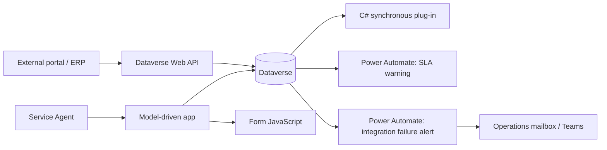

# Architecture

## High-level design

## Responsibilities
- **Model-driven app:** agent workspace, views, forms, dashboards, command bar.
- **JavaScript:** fast user feedback only; never the sole enforcement layer.
- **Plug-in:** server-side validation and SLA target calculation for all clients.
- **Power Automate:** asynchronous notifications, scheduled checks, and operational alerts.
- **Dataverse:** source of truth, relationships, security, auditing, and transaction boundary.
- **Web API:** authenticated external integration using Microsoft Entra ID app registration and least privilege.

## Key design decisions
1. Validate critical rules on the server because imports and API requests can bypass form scripts.
2. Keep synchronous plug-ins short and deterministic.
3. Use asynchronous automation for email/Teams notifications so a notification outage does not block case creation.
4. Store external correlation IDs and integration status to support troubleshooting and idempotency.
5. Use environment variables and connection references for ALM; never hard-code environment URLs or credentials.
6. Prefer standard Customer Service SLA capabilities for production SLA calendars and pause/resume behavior.
